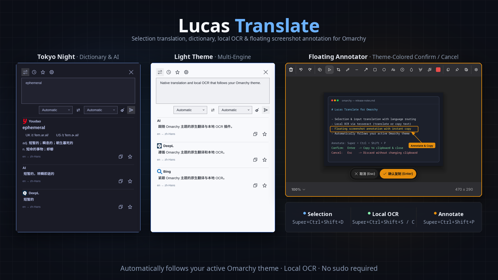

# Lucas Translate for Omarchy

[](https://github.com/lucaslus/lucas-translate-omarchy/actions/workflows/omarchy-native.yml)

Omarchy 桌面上的划词翻译、查词、本地 OCR 与悬浮截图标注工具。配色、圆角和字体自动跟随当前 Omarchy 主题。



## 核心功能

### 划词与输入翻译
选中任意文字按 `Super+Ctrl+Shift+D` 直接翻译，没有选区时打开空白输入框。支持按语言自动选择目标语种，单个渠道超时或报错可以单独重试。划词优先读取无障碍选区，不支持时临时读取剪贴板并自动还原原内容。

### 词典、免费翻译与 AI 流式输出
内置有道词典（带英美音标与真人发音）、Bing 和 DeepL 免费翻译。也可以在设置页填入 DeepL 官方 API、OpenAI 兼容接口或本地 Ollama，AI 译文支持边生成边显示和随时取消。五个服务支持直接拖拽排序。

### 本地截图 OCR
按 `Super+Ctrl+Shift+S` 框选屏幕文字，在本地识别后直接翻译。按 `Super+Ctrl+Shift+C` 只把识别出的文字复制到剪贴板，不弹窗也不联网发送图片。

### 悬浮截图标注
按 `Super+Ctrl+Shift+P` 框选屏幕后弹出居中的悬浮编辑窗口，支持画框、箭头、马赛克和文字标注。底部居中的悬浮按钮条自动跟随当前 Omarchy 主题色，点「确认复制 (Enter)」或按 `Enter` 把结果复制到剪贴板并关闭；点「取消 (Esc)」、按 `Esc` 或点击窗口外部直接丢弃，不改原剪贴板，临时截图关闭即删。

### 历史、收藏与主题跟随
翻译记录和收藏保存在本地，支持关键词搜索、展开查看全部引擎结果和一键重译。切换 Omarchy 主题时窗口实时生效，快捷键和历史保留上限都可以在设置页调整。

## 常用快捷键

安装后可通过顶栏图标打开，或使用以下默认快捷键（可在设置页自定义）：

| 功能 | 默认快捷键 | 命令 |
| --- | --- | --- |
| 打开翻译面板 | 点击顶栏图标 | `lucas-translate-native --show` |
| 新建空白输入 | `Super+Ctrl+Shift+I` | `lucas-translate-native --input` |
| 显示 / 隐藏面板 | `Super+Ctrl+Shift+T` | `lucas-translate-native --toggle` |
| 划词翻译 | `Super+Ctrl+Shift+D` | `lucas-translate-native --selection` |
| 截图识别并翻译 | `Super+Ctrl+Shift+S` | `lucas-translate-native --screenshot` |
| 截图 OCR 复制文字 | `Super+Ctrl+Shift+C` | `lucas-translate-native --ocr` |
| 悬浮截图标注 | `Super+Ctrl+Shift+P` | `lucas-translate-native --annotate` |

面板内按 `Enter` 翻译，`Shift+Enter` 换行，`Esc` 取消并隐藏，`Ctrl+L` 全选输入框，`Ctrl+Up/Down` 切换结果，`Ctrl+Shift+C` 复制当前译文。

## 安装前需要准备什么

请在已解锁的 Omarchy 桌面上运行，不要在锁屏状态下安装或更新。

- 基础运行：`python3`、`wl-clipboard`，以及 Omarchy 自带的 `omarchy`、`omarchy-shell`、`hyprctl`
- 截图 OCR（可选）：`grim`、`slurp`、`tesseract` 及中英文语言包（`eng`、`chi_sim`）
- 词典发音（可选）：`mpv`
- API 密钥保存（可选）：已解锁的系统密钥环（Secret Service）
- 截图标注（可选）：`lucas-screenshot-editor`（构建方式见 [开发文档](docs/DEVELOPMENT.md#optional-screenshot-editor)）
- 仅在从源码编译时需要：`git`、Rust / Cargo、C/C++ 编译工具、`pkg-config`、`libdbus` 开发包

## 安装与更新

### 方式一：下载预编译包（无需安装 Rust）

从 [Releases](https://github.com/lucaslus/lucas-translate-omarchy/releases) 下载对应架构的压缩包（尚无正式 Release 时可从最近一次通过的 [Native checks](https://github.com/lucaslus/lucas-translate-omarchy/actions/workflows/omarchy-native.yml) 下载 `omarchy-native` 产物并先解压外层 ZIP）：

```sh
tar -xzf lucas-translate-omarchy-0.1.0-x86_64.tar.gz
cd lucas-translate-omarchy
python3 scripts/install-omarchy-native.py --binary bin/lucas-translate-omarchy-backend
```

### 方式二：从源码安装

```sh
git clone https://github.com/lucaslus/lucas-translate-omarchy.git
cd lucas-translate-omarchy
python3 scripts/install-omarchy-native.py
```

安装器会先备份将要改动的桌面文件再执行安装，失败时自动回滚；遇到快捷键冲突会留空并在设置页提示原因。请以普通桌面用户运行，切勿以 root 权限执行（No sudo or pkexec is required.）。如果不想让安装器修改 Hyprland 快捷键，可加上 `--without-shortcuts`。

仅运行 `omarchy plugin add` 只会下载界面文件，不会安装本地翻译服务，完整安装和升级请运行上面的安装器。源码升级只需拉取最新代码后再运行一次 `python3 scripts/install-omarchy-native.py`。

## 卸载与数据位置

- 只通过 `omarchy plugin add` 安装的界面文件，直接执行 `omarchy plugin remove lucas.translate` 即可移除。
- 通过安装器完整安装的，目前没有一键卸载脚本：先运行 `omarchy plugin disable lucas.translate`，再按安装时打印的备份目录（默认在 `~/.local/state/lucas-translate-omarchy/install-backups/`）恢复或移除相关文件，详细步骤见 [回退与卸载说明](docs/MIGRATION.md#回退与卸载)。
- 个人配置、历史和收藏保存在 `~/.local/share/lucas-translate-omarchy/`，诊断日志在 `~/.local/state/lucas-translate-omarchy/logs/`（不记录原文、译文或密钥）。

如果你使用 macOS、Windows 或普通 Linux 桌面，请前往桌面版仓库 [lucaslus/luca-translate](https://github.com/lucaslus/luca-translate)。开发与构建说明见 [开发文档](docs/DEVELOPMENT.md)。

## 许可证

本仓库使用 [MIT](LICENSE) 许可证。可选截图标注编辑器基于上游 Tensaku，保留其 MPL-2.0 许可声明（[NOTICE](packaging/editor/NOTICE)）。应用图标 `assets/lucas-translate.png` 来自 [lucaslus/luca-translate](https://github.com/lucaslus/luca-translate)，同样遵循 MIT 许可。

## English overview

Lucas Translate (`lucas.translate`) adds quick selection translation, dictionary lookup with phonetics and audio, local screenshot OCR, and an optional floating screenshot annotation editor to Omarchy. Its colors, corners, and fonts follow your active Omarchy theme automatically.

Main features:
- Selection and input translation (`Super+Ctrl+Shift+D` / `Super+Ctrl+Shift+I`) with per-language target rules and per-provider retry.
- Built-in Youdao dictionary (UK/US phonetics and audio), free Bing and DeepL translation, plus DeepL API and OpenAI-compatible or local Ollama streaming.
- Local screenshot OCR via `tesseract` to translate (`Super+Ctrl+Shift+S`) or copy text straight to the clipboard (`Super+Ctrl+Shift+C`).
- Optional floating screenshot annotation window (`Super+Ctrl+Shift+P`) with a theme-colored bottom action bar for Confirm Copy (`Enter`) and Cancel (`Esc`).
- Searchable local history, favorites, draggable provider order, and configurable shortcuts.

No sudo or pkexec is required. The installer runs as the desktop user only and refuses to run as root or while locked.

External dependencies: `python3`, `wl-clipboard`, `omarchy`, `omarchy-shell`, and `hyprctl` for core use; `git`, Rust (`cargo`), C/C++ build tools, `pkg-config`, and `libdbus` headers when building from source; optional `grim`, `slurp`, `tesseract` (`eng`, `chi_sim`), `mpv`, an unlocked Secret Service keyring, and `lucas-screenshot-editor`.

Running `omarchy plugin add https://github.com/lucaslus/lucas-translate-omarchy.git --enable` clones the Shell plugin files only and does not install the companion backend executable. For a complete install or update, run the installer on an unlocked Omarchy desktop:

```sh
python3 scripts/install-omarchy-native.py
```

Add `--without-shortcuts` to keep your existing Hyprland keybindings, or `--binary <path>` when installing from a release archive. Every modified file is backed up under `~/.local/state/lucas-translate-omarchy/install-backups/` before installation and restored automatically if a step fails.

To remove a plugin added only via `omarchy plugin add`, run `omarchy plugin remove lucas.translate`. To remove a full installation, run `omarchy plugin disable lucas.translate`, restore or remove the managed files from your install backup as listed in [docs/MIGRATION.md](docs/MIGRATION.md#回退与卸载), and reload with `omarchy-shell shell rescanPlugins`, `omarchy-shell shell reloadConfig`, and `hyprctl reload`. Your personal history and settings under `~/.local/share/lucas-translate-omarchy/` stay untouched unless you delete that folder manually.
